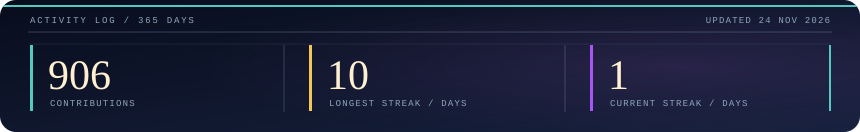

<!-- markdownlint-disable MD033 -->

<table width="100%">
  <tr>
    <td width="70%" align="left" valign="middle">
      
    </td>
    <td width="30%" align="right" valign="middle">
      
    </td>
  </tr>
</table>

