<!-- markdownlint-disable MD033 MD041 -->

  

  <h1>KAELITH69</h1>
  
<strong>Systems · Tooling · Automation · Creative Engineering</strong>

  
KERALA, INDIA &nbsp;·&nbsp; IST UTC+5:30 &nbsp;·&nbsp; BUILDING WITH INTENT

---

  

## 02 / Engineering arsenal

  

## 03 / Active missions

  

## 04 / Selected expeditions

A few systems from the workshop. Each project solves a different kind of problem.

<table>
  <tr>
    <td width="50%" valign="top">
      <h3><a href="https://github.com/Kaelith69/CineCommon">CineCommon</a></h3>
      
A local-first Android movie community with watchlists, spoiler-aware reviews, trust-based metadata edits and an on-device catalogue.

      KOTLIN · JETPACK COMPOSE · ROOM · COROUTINES
    </td>
    <td width="50%" valign="top">
      <h3><a href="https://github.com/Kaelith69/WRDLiNK-Web">WRDLiNK</a></h3>
      
A browser-based word ladder game powered by graph search, dictionary validation, shortest-path hints and offline-first play.

      JAVASCRIPT · GRAPH SEARCH · PWA
    </td>
  </tr>
  <tr>
    <td width="50%" valign="top">
      <h3><a href="https://github.com/Kaelith69/Prism">Prism</a></h3>
      
An AI presentation studio that turns a topic into structured slides, deterministic SVG visuals and widescreen PDF exports.

      NODE.JS · VANILLA JS · LLAMA · GROQ
    </td>
    <td width="50%" valign="top">
      <h3><a href="https://github.com/Kaelith69/GodView">GodView</a></h3>
      
A zero-build dashboard module with configurable metrics, geospatial views, live search and CSV export.

      ES6 MODULES · LEAFLET · DATA VISUALIZATION
    </td>
  </tr>
  <tr>
    <td width="50%" valign="top">
      <h3><a href="https://github.com/Kaelith69/ORION">ORION</a></h3>
      
An anonymous real-time chat platform pairing strangers for private, ephemeral conversations.

      NODE.JS · EXPRESS · SOCKET.IO
    </td>
    <td width="50%" valign="top">
      <h3><a href="https://github.com/Kaelith69">More from the workshop</a></h3>
      
Browse experiments, utilities, prototypes and ongoing explorations across the repository archive.

      OPEN SOURCE · EXPERIMENTS · CONTINUOUS LEARNING
    </td>
  </tr>
</table>

## 05 / Exploration archive

  

## 06 / Engineering telemetry

  

  

  

## 07 / Signal channels

  

  <a href="https://discord.com/users/1413084975938539540">DISCORD</a>
  &nbsp;·&nbsp;
  <a href="https://instagram.com/kaelith6.9">INSTAGRAM</a>
  &nbsp;·&nbsp;
  <a href="https://github.com/Kaelith69">GITHUB</a>

  

  

